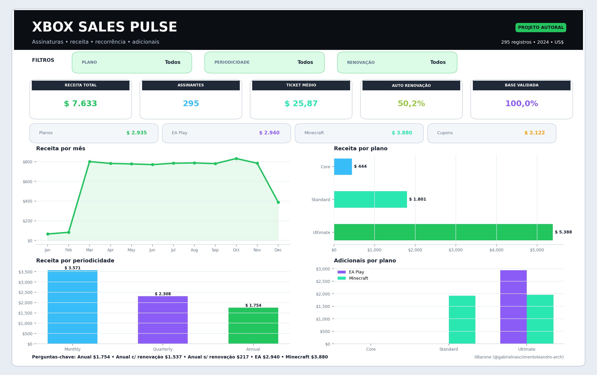
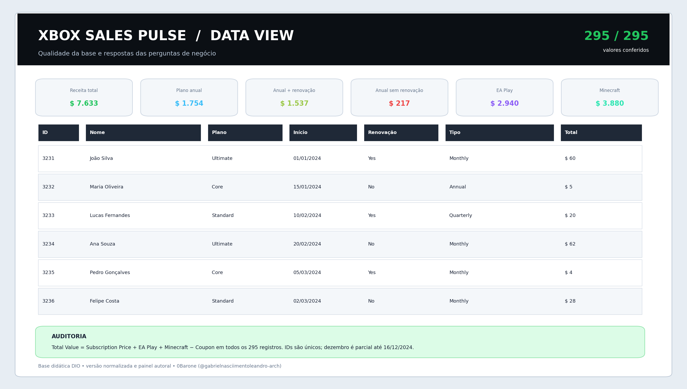

# Xbox Sales Pulse


Dashboard autoral desenvolvido para o desafio **“Criando um Dashboard de Vendas do Xbox com Excel”**, da DIO. O projeto transforma 295 registros de assinaturas em uma visão executiva sobre receita, planos, periodicidade, renovação automática e serviços adicionais.

> **Entrega principal:** [`xbox_sales_pulse.xlsx`](./xbox_sales_pulse.xlsx)



## Objetivo

Converter a base bruta do desafio em informações visuais claras e auditáveis, permitindo responder rapidamente às perguntas de negócio sem ocultar a origem dos cálculos.

A solução foi construída do zero com identidade, organização, fórmulas, gráficos, documentação e scripts próprios. Nenhum dashboard finalizado de terceiros foi usado como modelo ou incorporado ao arquivo.

## Principais resultados

| Indicador | Resultado |
|---|---:|
| Assinaturas | **295** |
| Receita total | **US$ 7.633,00** |
| Ticket médio | **US$ 25,87** |
| Receita-base dos planos | **US$ 2.935,00** |
| Receita de EA Play | **US$ 2.940,00** |
| Receita de Minecraft | **US$ 3.880,00** |
| Cupons concedidos | **US$ 2.122,00** |
| Auto Renewal = Yes | **148 clientes / 50,2%** |
| Registros validados | **295 de 295** |

### Respostas às perguntas do desafio

| Pergunta | Resposta |
|---|---:|
| Faturamento total com planos anuais | **US$ 1.754,00** |
| Faturamento anual com renovação automática | **US$ 1.537,00** |
| Faturamento anual sem renovação automática | **US$ 217,00** |
| Total vendido em assinaturas do EA Play | **US$ 2.940,00** |
| Total vendido em assinaturas do Minecraft | **US$ 3.880,00** |

## O dashboard

O arquivo possui três filtros por lista, que recalculam cartões e gráficos:

- **Plano:** Todos, Core, Standard e Ultimate;
- **Periodicidade:** Todos, Monthly, Quarterly e Annual;
- **Renovação:** Todos, Yes e No.

A área executiva reúne:

- cinco cartões de desempenho;
- quatro componentes da receita;
- evolução mensal;
- receita e quantidade por plano;
- receita e quantidade por periodicidade;
- adesão a EA Play e Minecraft por plano;
- bloco com as respostas centrais do desafio.



## Estrutura da pasta de trabalho

| Aba | Finalidade |
|---|---|
| `Dashboard` | Painel principal, filtros, indicadores e quatro gráficos |
| `Análise` | Cálculos dinâmicos, séries dos gráficos e respostas de negócio |
| `Base` | Dados normalizados em tabela estruturada, com colunas de auditoria |
| `Dicionário` | Definição dos campos, tipos e regras de cálculo |
| `Guia` | Instruções de uso, leitura e limitações |
| `Apoio` | Listas usadas pelos filtros; fica oculta por padrão |

Todas as abas visíveis possuem navegação interna. O arquivo não contém macros nem vínculos externos de pasta de trabalho.

## Metodologia

O valor de cada assinatura foi conferido pela regra:

```text
Total Value = Subscription Price + EA Play + Minecraft − Coupon Value
```

A auditoria confirmou a igualdade nos **295 registros**. A planilha usa:

- tabela estruturada `tblAssinaturas`;
- intervalos nomeados;
- `SUMIFS`, `COUNTIFS`, `IFERROR`, `DATE`, `TEXT` e fórmulas auxiliares;
- validação de dados para os filtros;
- cache de resultados para uma primeira visualização consistente;
- recálculo automático ao abrir ou alterar um filtro no Excel.

A metodologia completa está em [`docs/METODOLOGIA.md`](./docs/METODOLOGIA.md), o dicionário em [`docs/DICIONARIO_DE_DADOS.md`](./docs/DICIONARIO_DE_DADOS.md) e o relatório de validação em [`docs/VALIDACAO.md`](./docs/VALIDACAO.md).

## Destaques analíticos

1. **Ultimate concentra 70,6% da receita**, com US$ 5.388,00.
2. **87,6% da receita anual** está associada à renovação automática.
3. **Minecraft é o maior adicional**, com US$ 3.880,00, frente a US$ 2.940,00 do EA Play.
4. A quantidade de clientes com e sem renovação é praticamente equilibrada: **148 contra 147**.
5. A série mensal deve ser lida com cautela: janeiro e fevereiro têm apenas dois registros cada, e dezembro termina em **16/12/2024**.

## Como usar

1. Baixe e abra [`xbox_sales_pulse.xlsx`](./xbox_sales_pulse.xlsx) no Microsoft Excel.
2. Acesse a aba `Dashboard`.
3. Escolha os valores nas células verdes de Plano, Periodicidade e Renovação.
4. Use `Todos` para remover um filtro.
5. Consulte `Análise` para conferir os números e `Guia` para entender as regras.

O arquivo foi projetado para o Excel moderno. Outros editores podem recalcular as fórmulas, mas apresentar pequenas diferenças de layout ou gráficos.

## Como reproduzir

### Pré-requisitos

- Python 3.10 ou superior;
- pacotes listados em `requirements.txt`;
- Microsoft Excel apenas para interação com o arquivo final — não é necessário para gerar ou validar o projeto.

### Execução

```bash
git clone https://github.com/gabrielnasciimentoleandro-arch/xbox-sales-pulse-excel.git
cd xbox-sales-pulse-excel
python -m venv .venv
```

Ative o ambiente virtual:

```bash
# Windows
.venv\Scripts\activate

# Linux/macOS
source .venv/bin/activate
```

Instale as dependências e execute o fluxo:

```bash
pip install -r requirements.txt
python scripts/gerar_dashboard.py
python scripts/gerar_previas.py
python scripts/gerar_relatorio.py
python scripts/verificar_dashboard.py
```

A última etapa deve terminar com `VALIDAÇÃO APROVADA`.

## Estrutura do repositório

```text
xbox-sales-pulse-excel/
├── data/
│   ├── base.xlsx                       # base original preservada
│   └── assinaturas_xbox.csv            # exportação normalizada
├── docs/
│   ├── dashboard-geral.png
│   ├── data-view.png
│   ├── xbox-sales-pulse-apresentacao.pdf
│   ├── METODOLOGIA.md
│   └── VALIDACAO.md
├── scripts/
│   ├── gerar_dashboard.py
│   ├── gerar_previas.py
│   ├── gerar_relatorio.py
│   └── verificar_dashboard.py
├── xbox_sales_pulse.xlsx
├── CHECKSUMS.sha256
├── requirements.txt
├── CHANGELOG.md
├── LICENSE
└── README.md
```

## Dados e integridade

A base pública do desafio foi preservada em `data/base.xlsx`.

```text
SHA-256: 0b60de55f2e54ef2759b6363fe1ef1436ea7ce3de5493ddd5f0e987ac8052a13
Registros: 295
Período: 01/01/2024 a 16/12/2024
```

Os hashes dos artefatos finais estão em [`CHECKSUMS.sha256`](./CHECKSUMS.sha256).

Origem pública utilizada para recuperação da base: [`anadomarketing/exercicio-dio-dashboardxbox`](https://github.com/anadomarketing/exercicio-dio-dashboardxbox). A referência serviu somente para obter a planilha de dados; dashboard, código, documentação e identidade visual deste repositório são autorais.

## Limitações

- a base é didática e cobre somente 2024;
- janeiro e fevereiro possuem baixa quantidade de registros;
- dezembro é parcial, encerrando em 16/12;
- os resultados descrevem a base fornecida e não representam dados corporativos oficiais da Microsoft ou do Xbox;
- para uso com dados pessoais reais, seria necessário aplicar anonimização, controle de acesso e política de retenção.

## Apresentação

Uma versão curta para portfólio está disponível em [`docs/xbox-sales-pulse-apresentacao.pdf`](./docs/xbox-sales-pulse-apresentacao.pdf).

## Autor

**0Barone** — [@gabrielnasciimentoleandro-arch](https://github.com/gabrielnasciimentoleandro-arch)

## Licença

Código, documentação e elementos autorais deste projeto são disponibilizados sob a [Licença MIT](./LICENSE). A base do desafio permanece sujeita aos termos de sua fonte original.

---

Microsoft, Xbox, EA Play e Minecraft são marcas de seus respectivos proprietários. Este é um projeto educacional independente, sem afiliação ou endosso das empresas citadas.
